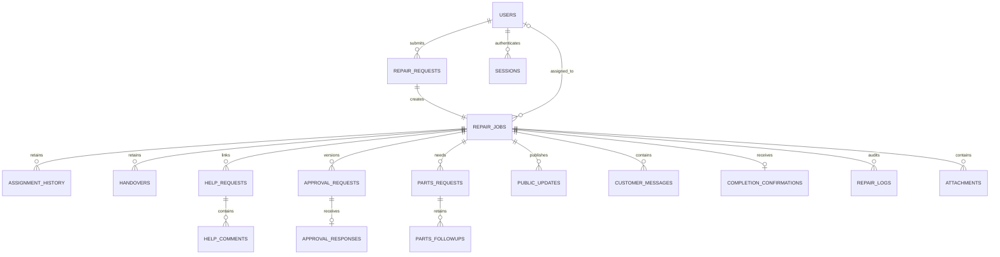
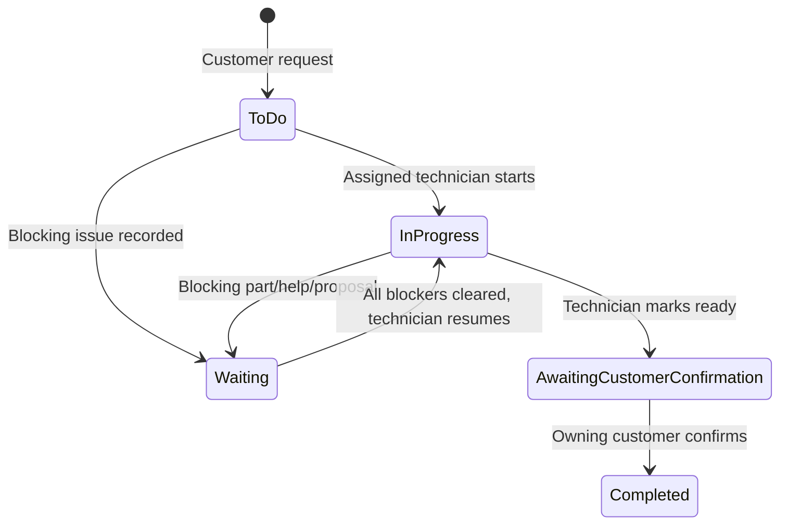

# Persistent data and role rules

The relational implementation has 16 business tables plus one authentication-session table. The supplied Core ERD was a proposal; this is the implemented relation map. A customer request and its job are distinct linked records with a unique request reference, not separate customer/manager/technician copies of a repair. A job is created transactionally with the request in this implementation. Photos live in the attachments table as binary data. Foreign keys are enforced on every connection.

The executable schema is `backend/schema.sql`. Names in the diagram are case-insensitive representations of the snake_case SQL names. User foreign keys on authored records are omitted from this diagram for readability but enforced in SQL. `repair_jobs.current_approval_request_id` references the current proposal; one pending proposal per job and one response per proposal are enforced by unique constraints. One final customer confirmation per job is also enforced. Author and timestamp records remain after reassignment. Hard deletion is not exposed.

Every existing-job write acquires a SQLite write transaction, checks the expected version and business state, updates associated records, appends an operation log and increments the version before committing. Exceptions roll back all changes. SQLite WAL and a 15-second busy timeout support several classroom clients on one application instance. This is not a horizontally scaled or multi-shop system; use one process/service instance on a local persistent disk. Schema version 1 is initialized idempotently; a database with a newer version is rejected rather than downgraded. Future schema changes need explicit migrations and a verified backup.

## Visibility

| Role | Reads | Writes |
| --- | --- | --- |
| Customer | Own request/job, public updates, proposals/responses, customer conversation, public photos, final confirmation | Own new requests, messages, public photos, proposal responses and final confirmation in allowed states |
| Technician | Currently assigned repairs and internal history; own sent/received help conversations | Assigned repair start/resume/ready, handovers, published progress, shortages, new help; participant help actions |
| Manager | All shop repairs, staff directory, internal repair history, parts/procurement, help status | Assignment, progress, conversation, attachments, parts follow-up, proposal publication/revision/withdrawal, account creation |

The new web workspace authenticates each user. The old root HTML/JavaScript files remain as the existing static classroom demonstration; its role switching is not authentication and its data is not imported into the database automatically. The backend serves `web/index.html`, not the root prototype. Its role-specific forms use the relational API rather than browser-session persistence. Browser drafts remain only in the current page's memory and are cleared on sign-out; there is no claim of guaranteed draft recovery after closing the browser.

## Preserved business transitions

The SQL status strings are `To Do`, `In Progress`, `Waiting`, `Awaiting Customer Confirmation`, `Completed`. Parts, help and current proposal blockers are evaluated independently. Published progress is information and does not bypass transitions. Final states prohibit changing technical work; customer/staff messages and photos may still be added while awaiting confirmation, but a Completed repair is read-only. No action represents payment, actual supplier ordering or repair-performance evidence.
